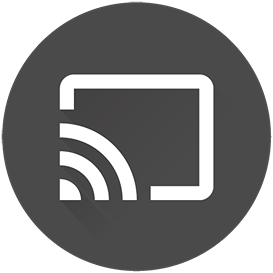

<h1 align="center">
  Continuously Casting Dashboards
</h1>


<p align="center">
  
</p>

<p align="center">
  <strong>Keep your Home Assistant dashboards always visible on Chromecast displays</strong>
</p>

<p align="center">
  <a href="#installation">Installation</a> •
  <a href="#quick-start">Quick Start</a> •
  <a href="#configuration">Configuration</a> •
  <a href="ROADMAP.md">Roadmap</a> •
  <a href="#-migrating-from-yaml-to-ui">Migration</a> •
  <a href="#troubleshooting">Troubleshooting</a>
</p>

---

A Home Assistant integration that casts dashboards to Chromecast-compatible displays and monitors them for recovery. It respects eligible time windows, entity states, active media and Assistant activity before attempting to resume a dashboard.

**Repository status (6 November 2026):** PRs [#2](https://github.com/anaschillin/continuously_casting_dashboards/pull/2), [#3](https://github.com/anaschillin/continuously_casting_dashboards/pull/3), [#4](https://github.com/anaschillin/continuously_casting_dashboards/pull/4), and [#5](https://github.com/anaschillin/continuously_casting_dashboards/pull/5) have been merged into `main`. The integration manifest currently declares version `2.1.0`; merging does **not** by itself publish a new HACS release. Optional frontend readiness is diagnostic-only, not an automatic fix for JavaScript card loading.

See [ROADMAP.md](ROADMAP.md) for implemented and unfinished work, and [the upgrade guide](docs/update_help.md) before switching from another installation source.

<p align="center">
  
</p>

## ✨ Features

- **Auto-resume** - Dashboard automatically restarts if interrupted
- **Smart detection** - Won't interrupt Spotify, Netflix, YouTube, timers, or Google Assistant
- **Time windows** - Only cast during specified hours (e.g., 7am-11pm)
- **Multiple dashboards** - Different dashboards at different times on the same device
- **Entity control** - Start/stop casting based on any Home Assistant entity state
- **Speaker group aware** - Won't cast if device is part of an active speaker group
- **Per-device settings** - Volume, time windows, and dashboards configured per device
- **Independent dashboard rules** - Checks each dashboard's own schedule and required entity state before selecting it
- **Continuous casting** - Opt out of global and custom time windows on an individual dashboard
- **Preserve device volume** - Opt out of initial muting and all explicit volume changes
- **Reliable DashCast status** - Detects active DashCast sessions using the correct HA Cast entity to avoid unnecessary recasts
- **Timeout recovery** - Retries after repeated status timeouts while respecting active/paused media and a five-minute media grace period
- **Google TV keepalive (opt-in)** - Sends MENU through a selected Home Assistant remote entity to prevent ambient mode
- **Resilient discovery** - Supports Google-suffixed device names without unsafe prefix matching
- **Per-device reconnect backoff** - Limits repeated reconnect failures without permanently disabling recovery
- **Diagnostics** - Exposes discovery metadata, retry delay, and failure reason through HA diagnostics and status sensors
- **Optional frontend readiness** - Companion Lovelace card reports whether required custom elements registered, with safe diagnostic-only heartbeat monitoring
- **Dashboard priorities and rotation** - Higher-priority eligible views take precedence; optionally rotate equally ranked views
- **Manual overrides** - Select a configured dashboard temporarily and clear the override through HA actions

## 📋 Requirements

Before installing, ensure you have:

| Requirement | Description |
|-------------|-------------|
| **Reachable dashboard URL** | The Cast device must be able to load the configured Home Assistant dashboard. The integration accepts `http://` and `https://` URLs; use HTTPS when practical. |
| **Dashboard authentication** | The receiver must be able to access the dashboard. If trusted networks are necessary, restrict them to specific Cast device IPs ([setup guidance](#trusted-networks-setup)). |
| **CATT** | The integration requires the CATT command (currently pinned in the manifest as `catt==0.12.13`). |
| **ha-catt-fix** | Recommended for affected devices if the display times out; see [installation guidance](#install-ha-catt-fix). |
| **Kiosk Mode** | *Optional*—hides Home Assistant navigation bars ([project](https://github.com/NemesisRE/kiosk-mode)). |

## 📦 Installation

### Via HACS (Recommended)

1. Open HACS in Home Assistant
2. Open the three-dot menu (⋮) and select **Custom repositories**.
3. Add `https://github.com/anaschillin/continuously_casting_dashboards` as an **Integration**.
4. Locate **Continuously Casting Dashboards**, then download/update it.
5. Restart Home Assistant.

This is the **fork containing PRs #2–#5**. The original [b0mbays repository](https://github.com/b0mbays/continuously_casting_dashboards) is a separate code source. Do not configure both repositories to install the same `continuously_casting_dashboards` integration simultaneously. If migrating from the upstream version, review [the upgrade guide](docs/update_help.md) and back up your configuration first.

Being available as a HACS **custom repository** does not mean that this fork has been accepted into the default HACS catalogue.

### Manual Installation

1. Download the `continuously_casting_dashboards` folder from this repository
2. Copy it to `config/custom_components/`
3. Restart Home Assistant

## 🚀 Quick Start

### 1. Add the Integration

1. Go to **Settings** → **Devices & Services**
2. Click **Add Integration**
3. Search for "Continuously Casting Dashboards"
4. Follow the setup wizard

### 2. Configure Your First Device

The wizard will guide you through:

1. **Global settings** - Logging level, cast delay, default time window
2. **Add device** - Enter your Chromecast display name (from Google Home app), its IP address, or both. At least one is required. You can also set an optional alias as a display name.
3. **Dashboard URL** - The full URL to your dashboard (e.g., `http://192.168.1.100:8123/lovelace/dashboard?kiosk`)

> **Tip:** Use a reachable IP address or DNS hostname; local mDNS names such as `homeassistant.local` may not resolve reliably from Cast devices. Either HTTP or HTTPS may be accepted, but all authentication, certificate and network restrictions still apply.

### 3. Done!

The integration will start casting your dashboard during the configured time window.

---

## ⚙️ Configuration

### UI Configuration (Recommended)

All settings can be managed through **Settings** → **Devices & Services** → **Continuously Casting Dashboards**.

**Managing device dashboards**
- Click **Configure** on a device to edit its dashboard settings in a single form.
- To add another dashboard, enable **“Add another dashboard after saving”**.
- If a device has multiple dashboards, use **“Edit a different dashboard”** to switch which one you’re editing.

### YAML Configuration (Legacy)

> **Note:** UI configuration is now the recommended method. YAML configuration is supported for backward compatibility but new features may only be available in the UI.

Add to your `configuration.yaml`:

```yaml
continuously_casting_dashboards:
  logging_level: warning    # debug, info, warning, error, critical
  cast_delay: 45            # Seconds between device checks (5-300)
  start_time: "07:00"       # Global start time (HH:MM)
  end_time: "01:00"         # Global end time (HH:MM)

  devices:
    "Living Room Display":  # Device name from Google Home app
      - dashboard_url: "http://192.168.1.100:8123/lovelace/home?kiosk"
        volume: 5           # Optional: 0-100
        start_time: "06:00" # Optional: Override global time
        end_time: "23:00"

    "Kitchen Hub":
      - dashboard_url: "http://192.168.1.100:8123/lovelace/kitchen?kiosk"
        volume: 7
```

### Configuration Options

| Option | Required | Default | Description |
|--------|----------|---------|-------------|
| `logging_level` | Yes | `warning` | Log verbosity: `debug`, `info`, `warning`, `error`, `critical` |
| `cast_delay` | Yes | `45` | Seconds between checking each device (5-300) |
| `start_time` | No | `07:00` | When to start casting (HH:MM format) |
| `end_time` | No | `01:00` | When to stop casting (HH:MM format) |
| `switch_entity_id` | No | - | Entity that controls casting on/off globally |
| `switch_entity_state` | No | `on` | State value that enables casting |
| `enable_notifications` | No | `true` | Show a HA notification when a device becomes unreachable |

### Per-Device Options

| Option | Required | Default | Description |
|--------|----------|---------|-------------|
| `dashboard_url` | Yes | - | Full URL to the dashboard |
| `volume` | No | - | Device volume (0-100); ignored if `preserve_volume` is enabled |
| `preserve_volume` | No | `false` | Never mute or set device volume while casting |
| `cast_continuously` | No | `false` | Ignore global and per-dashboard time windows, but still respect entity controls |
| `priority` | No | `0` | Higher priorities win among eligible dashboards (0–100) |
| `rotation_seconds` | No | `0` | Rotate equally ranked eligible dashboards; set on the first ranked dashboard (0 = disabled) |
| `start_time` | No | Global | Override the global start time |
| `end_time` | No | Global | Override the global end time |
| `switch_entity_id` | No | - | Entity that controls this specific device |
| `switch_entity_state` | No | `on` | State value that enables casting for this device |
| `speaker_groups` | No | - | Speaker groups to check before casting |
| `remote_device_for_keepalive` | No | Disabled | Home Assistant `remote.*` entity used to keep Google TV awake (sends MENU when the configured dashboard is active) |
| `verify_readiness` | No | `false` | Opt-in readiness telemetry; requires the companion Lovelace card and reports custom-element registration, not actual rendering |

### Dashboard rules, scheduling, and volume

For each Cast device, every dashboard is evaluated against its own time window (or `cast_continuously: true`) **and** required entity state. The **highest-priority eligible dashboard** wins; when priorities tie, configured order wins unless rotation is enabled. A disabled dashboard does not hide an eligible fallback. When no dashboard qualifies, the integration stops its active dashboard cast without intentionally stopping unrelated media.

- To cast without schedule restrictions, enable **Cast continuously** in that dashboard's settings. Entity conditions still apply.
- To avoid sound-level changes, enable **Keep device volume unchanged**. When enabled, the integration does not run CATT volume commands, including initial volume zero.
- Without these options, existing behaviour remains: the global time window applies unless overridden, and configured volume is still used.
- For legacy YAML dashboard entries, add `cast_continuously: true` or `preserve_volume: true` under the desired dashboard, not at the root.

For example:

```yaml
continuously_casting_dashboards:
  devices:
    "Kitchen Hub":
      - dashboard_url: "https://home.example/dashboard/day"
        start_time: "06:00"
        end_time: "22:00"
        switch_entity_id: "person.someone"
        switch_entity_state: "home"
      - dashboard_url: "https://home.example/dashboard/always"
        cast_continuously: true
        preserve_volume: true
```

Here both dashboards use the default priority `0`, so the first is preferred while its own time/entity rules match; otherwise the always-on entry is eligible as fallback. You can set a higher `priority` explicitly to change precedence. Existing configurations retain their defaults.

See the [development roadmap](ROADMAP.md) for merged functionality and remaining work.

### Priority selection and dashboard rotation

An eligible dashboard with the highest `priority` (0–100) wins. If priorities tie, the first eligible configured dashboard wins unless its `rotation_seconds` is greater than zero. In that case, equally ranked eligible dashboards rotate after that many seconds. Rotation is intentionally disabled by default; each switch triggers a new Cast operation.

If several dashboards should rotate, set the **same priority** on them and set `rotation_seconds` on the first of that priority group. Time windows, entity controls, Assistant detection and user-media protection still apply.

Use the Home Assistant `continuously_casting_dashboards.select_dashboard` service to **temporarily** prefer another configured dashboard. Indexes are zero-based and duration is 5–3600 seconds. Overrides cannot bypass the selected dashboard's schedule or required entity state:

```yaml
action: continuously_casting_dashboards.select_dashboard
data:
  device_name: "Kitchen Hub"
  dashboard_index: 1
  duration_seconds: 300
```

Clear it early with `continuously_casting_dashboards.clear_dashboard_override` and `device_name`. If multiple configured devices have the exact same name across integration entries, selection is refused to avoid affecting the wrong Cast device. Entity-triggered switches are debounced to reduce redundant scans.

### Home Assistant dashboard controls

Device status is exposed through Home Assistant sensors. You can create an ordinary Entities dashboard with status sensors and buttons calling `stop_casting`, `resume_casting`, `select_dashboard`, and `clear_dashboard_override`. These actions are available under **Developer Tools → Actions**.

A dedicated Lovelace multi-device control panel and lasting pause/resume controls are **not included in merged PRs #2–#5**; those enhancements are being developed separately. The existing `stop_casting` action stops an active dashboard once and is **not** an indefinite pause—monitoring may cast it again when normal conditions qualify.

### Device discovery, retries, and diagnostics

Chromecasts can now be discovered by an exact name **or** by a uniquely matched name ending in Google's observed `- Google Inc. Google …` suffix. Case-insensitive exact names take priority. Ambiguous or generic prefix matches fail closed; supply the Cast device's IP address or its exact name if resolution is ambiguous.

Concurrent device lookups share one CATT scan, with short-lived scan results and a lock to avoid a subprocess per display. Dashboard checks are processed with bounded concurrency. Timed-out CATT processes are terminated and reaped. Reconnection uses bounded exponential backoff (30 seconds up to 15 minutes) per device; a successful connection resets the delay. It never permanently stops trying after a fixed number of failures.

Home Assistant's integration diagnostics now provide device statuses, retry delays, scan state, and non-sensitive error summaries. Per-device diagnostic sensors expose `retry_in_seconds` and `last_error`. Dashboard URLs and authentication details are excluded from the diagnostics report. Sensor retry delays are a snapshot from the last status update and may be stale until refreshed.

**Compatibility note:** These changes are already merged into `main`, but do not replace CATT or guarantee behaviour on every Cast receiver. Verify recovery and media protection on your devices before relying on them for unattended operation.

### Optional dashboard frontend readiness (experimental)

A Cast receiver acknowledging a URL is not proof that your custom cards have registered or rendered correctly. This feature adds **diagnostic-only** reporting through a small Lovelace card; it does not recast, restart or modify the dashboard based on missing reports.

1. Enable **Monitor frontend readiness** on the dashboard in the integration editor.
2. Under **Settings → Dashboards → Resources**, add the bundled JavaScript module `/ccd_cast/ccd-readiness-card.js` with type **JavaScript module**.
3. Place this card on the dashboard view that is being cast:

```yaml
type: custom:ccd-readiness-card
device_name: Kitchen Hub
required_elements:
  - salah-timetable-card
interval_seconds: 30
hide: false
```

Use the same **configured device name** as the integration. Supply the actual custom-element tag names your dashboard depends on; `customElements.get()` checks registration, **not** visual rendering or loaded entity data. `hide: true` conceals the small status label, but might still reserve space depending on Lovelace layout. The companion can run on any browser opening the same dashboard; therefore the signal is best-effort, not proof of a specific Cast receiver.

Readiness appears as `frontend_readiness` in device sensor attributes and as a status in integration diagnostics. Possible values are `disabled`, `pending`, `ready`, `missing_elements`, `unconfirmed` (no report within two minutes), and `stale` (last report older than three minutes). Reports are sent via an authenticated Home Assistant service and include only the path, device name and missing tag names—no dashboard query parameters, passwords or access tokens.

**Important:** If the reporter's JavaScript fails to load on a Cast device, the integration cannot determine which page elements loaded. This is intentional: no automatic recovery is triggered from an absent report, avoiding unnecessary interruptions and recast loops.

### Cast reliability and Google TV keepalive

The integration uses Home Assistant's Cast media-player entity to recognize DashCast (app ID `84912283`) when `catt status` reports only volume. It requires the device's configured Chromecast name to match the HA Cast device name or its entity ID. It deliberately does **not** use an unrelated DashCast session as evidence that the target display is casting.

After repeated `catt status` timeouts, the integration can attempt a recovery cast. It checks Home Assistant media-player state and avoids interrupting active, paused, or buffering user media, with a **five-minute grace period** after media was last seen. Note that recovery after a timeout is best-effort; connectivity failures and unrecognized media apps still require care.

Google TV keepalive is disabled unless you select a `remote.*` entity in that dashboard's UI settings (or supply `remote_device_for_keepalive` in its legacy YAML dashboard configuration). The integration sends `MENU` only while the dashboard is already being monitored as connected. This keypress may be visible or disruptive on some TVs, so only enable it when necessary.

These changes incorporate upstream [PR #152](https://github.com/b0mbays/continuously_casting_dashboards/pull/152), [PR #153](https://github.com/b0mbays/continuously_casting_dashboards/pull/153), [PR #154](https://github.com/b0mbays/continuously_casting_dashboards/pull/154) and the [Home Assistant 2026.11 import fix from issue #161](https://github.com/b0mbays/continuously_casting_dashboards/issues/161).


---

## 🔧 Advanced Usage

### Multiple Dashboards Per Device

Cast different dashboards at different times:

```yaml
devices:
  "Office Display":
    - dashboard_url: "http://192.168.1.100:8123/lovelace/day?kiosk"
      start_time: "07:00"
      end_time: "18:00"
    - dashboard_url: "http://192.168.1.100:8123/lovelace/night?kiosk"
      start_time: "18:00"
      end_time: "23:59"
```

### Control Casting with Entity State

Control casting globally or per-device using any Home Assistant entity:

```yaml
# Create a toggle in configuration.yaml
input_boolean:
  enable_dashboard_casting:
    name: "Enable Dashboard Casting"
    initial: on

# Reference it in the integration config
continuously_casting_dashboards:
  switch_entity_id: "input_boolean.enable_dashboard_casting"
  # ... rest of config
```

**Default "on" states:** `on`, `true`, `home`, `open`

For custom states, use `switch_entity_state`:

```yaml
continuously_casting_dashboards:
  switch_entity_id: "sensor.house_mode"
  switch_entity_state: "occupied"
```

### Speaker Group Handling

Prevent casting when the device is playing in a speaker group:

```yaml
devices:
  "Kitchen Hub":
    - dashboard_url: "http://192.168.1.100:8123/lovelace/kitchen?kiosk"
      speaker_groups:
        - "Kitchen Speakers"
        - "Whole House Audio"
```

### Runtime Configuration via Services

Adjust settings without restarting using Home Assistant services:

```yaml
# Change cast delay
service: continuously_casting_dashboards.set_cast_delay
data:
  delay: 60

# Change time window
service: continuously_casting_dashboards.set_start_time
data:
  time: "08:00"

# Change logging level
service: continuously_casting_dashboards.set_logging_level
data:
  level: debug

# Stop a specific device (omit device_name to stop all)
service: continuously_casting_dashboards.stop_casting
data:
  device_name: "Living Room Display"

# Resume a specific device (omit device_name to check all)
service: continuously_casting_dashboards.resume_casting
data:
  device_name: "Living Room Display"
```

**Available services/actions:**
- `set_cast_delay` — Cast interval (5–300 seconds; see the configured monitoring schedule)
- `set_logging_level` — debug, info, warning, error, critical
- `set_start_time` / `set_end_time` — runtime global casting window (HH:MM)
- `stop_casting` — one-off stop on a device or all devices, **not** a persistent pause
- `resume_casting` — trigger a cast check on a device or all devices
- `select_dashboard` — temporarily prefer a dashboard by zero-based index, 5–3600 seconds
- `clear_dashboard_override` — return a named device to automatic priority/rotation selection
- `report_dashboard_ready` — internal diagnostic action used by the optional frontend reporter

---

## 🔄 Migrating from YAML to UI

If you're currently using YAML configuration (`configuration.yaml`), follow these steps to migrate to the new UI-based configuration:

For troubleshooting existing installations or switching from upstream to this fork, see [the upgrade guide](docs/update_help.md).

### Automatic Migration

1. **Update the integration** via HACS
2. **Restart Home Assistant**
3. Your YAML config will be **automatically imported** into the UI
4. A notification will appear confirming the import
5. **Remove** the `continuously_casting_dashboards:` section from your `configuration.yaml`
6. Restart Home Assistant again

Your devices will continue working. You can now manage everything through the UI.

### After Migration

Once migrated, each device appears separately on the integration page:

```
Settings → Devices & Services → Continuously Casting Dashboards
├── ⚙️ Configure (Global Settings)
├── 📱 Living Room Display → Configure
├── 📱 Kitchen Hub → Configure
└── ➕ Add Device
```

Click **Configure** on any device to manage its dashboards individually.
Use **“Add another dashboard after saving”** to add more dashboards for a device, and **“Edit a different dashboard”** when multiple dashboards exist.

> **Important:** Confirm that devices and dashboards appear correctly in the UI **before** removing the YAML section. Keep a backup; a YAML setup alongside a UI entry can cause repeated import warnings or conflicting configurations.

---

## 📖 Setup Guides

### Trusted Networks Setup

Cast receivers may not support Home Assistant's normal interactive login flow. If you use trusted network authentication, give access **only to the Cast device addresses you control**; this is a security-sensitive bypass, not a general LAN setting.

1. Find your Chromecast device IPs (Settings → Device Information → Technical Information on each device)

2. Add to your `configuration.yaml`:

```yaml
homeassistant:
  auth_providers:
    - type: trusted_networks
      trusted_networks:
        - 192.168.1.50/32   # Living Room Display
        - 192.168.1.51/32   # Kitchen Hub
      trusted_users:
        192.168.1.50: YOUR_USER_ID
        192.168.1.51: YOUR_USER_ID
      allow_bypass_login: true
    - type: homeassistant    # Keep normal login for other devices
```

> **Security:** Use exact `/32` device addresses, retain the normal `homeassistant` auth provider for other clients, and make sure Cast IP assignments are stable. Trusted authentication grants access from matching source addresses and should not be enabled broadly. Use a dedicated, least-privilege account where practical.

### Install ha-catt-fix

This prevents the dashboard from timing out after 10 minutes.

1. Open HACS → Click three dots (⋮) → **Custom repositories**
2. Add `swiergot/ha-catt-fix` as a **Dashboard** (previously called "Lovelace")
3. Go to **Frontend** tab → Search "ha-catt-fix" → **Download**
4. Restart Home Assistant
5. Verify installation: Open your dashboard → Edit → Manage resources → Confirm ha-catt-fix is listed

---

## ❓ Troubleshooting

### Home Assistant 2026.11 integration import error

In Home Assistant 2026.11, `EntityCategory` is imported from `homeassistant.const`. The fix reported in [upstream issue #161](https://github.com/b0mbays/continuously_casting_dashboards/issues/161) is **already merged into this fork's `main`**. Restart Home Assistant after updating the integration.

### DashCast dashboard keeps recasting every minute or few minutes

Confirm that the target display has a matching **Cast** `media_player` entity in Home Assistant and that its configured Chromecast name resolves to the same device. If the entity is missing or mismatched, the integration intentionally cannot infer which DashCast session belongs to it. Check debug logs for DashCast identity messages. Timeout recovery and optional Google TV keepalive serve different purposes and do not resolve custom-card JavaScript loading problems.


### Dashboard stops after a few seconds

**Cause:** ha-catt-fix not installed correctly.

**Solution:**
1. Set `logging_level: debug` in your config
2. Check Home Assistant logs for status output
3. Look for `Title: Dummy` in the logs - if missing, reinstall ha-catt-fix

```
DEBUG Status output for Office display: Title: Dummy 22:27:13 GMT+0000
```

### Device not found

**Possible causes:** no device discovered, ambiguous device name, network isolation, or an outdated device IP.

**Troubleshooting:**
- Check the name in Google Home and the device's network access.
- The integration accepts an **exact case-insensitive match** or a unique, recognized Google manufacturer/model suffix; generic prefix guessing is deliberately disabled.
- If there are similarly named devices, configure an explicit IP address under **IP Address**, then verify that it points to the intended Cast device.
- Download the integration diagnostics for discovery status and recent retry information.

### Dashboard won't cast

**Checklist:**
- [ ] The dashboard URL is reachable from the Cast receiver (HTTP/HTTPS, correct certificate if HTTPS).
- [ ] Authentication is configured appropriately for the receiver; trusted networks are one possible solution.
- [ ] The hostname or IP in the dashboard URL resolves from the Cast device.
- [ ] Current time is within the configured time window
- [ ] No media is playing on the device

### Device shows as unreachable

If a device temporarily loses connectivity, the integration can report it as disconnected, back off repeated failed reconnections, and create a persistent notification when enabled. Casting will be attempted again when the retry delay and normal eligibility/media checks allow it.

If you find the notifications noisy, the **Enable notifications** option is available under **Settings → Devices & Services → Continuously Casting Dashboards → Configure**. **Known limitation in merged PRs #2–#5:** the global options flow does not reliably persist an unchecked value; the fix is being developed separately. Confirm its saved value after reloading, rather than assuming the toggle has taken effect.

### Annoying phone notifications for "DashCast"

**Solution:** On your Android phone:
Settings → Google → Devices & sharing → Cast options → Turn off "Media controls for Cast devices"

---

## 💬 Support

- **Issues for this fork:** [anaschillin/continuously_casting_dashboards](https://github.com/anaschillin/continuously_casting_dashboards/issues)
- **Original upstream project:** [b0mbays/continuously_casting_dashboards](https://github.com/b0mbays/continuously_casting_dashboards)
- **Upgrade help:** [docs/update_help.md](docs/update_help.md)

---

<p align="center">
  <sub>Tested with Lenovo Smart Display 8, Google Nest Hub (1st Gen)</sub>
</p>
